<div align="center">


<p>
  <a href="https://github.com/DaddyUnikii/chainpulse/actions/workflows/ci.yml"></a>
  
  
  
</p>

<p>
  
  
  
  
  
</p>



</div>

---

## ✨ Features

<table>
<tr>
<td width="50%">

⚡ **Parallel checks** — every endpoint at once, results in about a second

🧱 **Block height & chain ID** — spot a stalled or misconfigured node instantly

⏱ **Latency** — sorted fastest first, failures always last

</td>
<td width="50%">

📦 **Zero dependencies** — pure Python standard library

🤖 **Script friendly** — `--json` output and a meaningful exit code

🛰 **Your own nodes** — check validators and private RPCs by URL or config

</td>
</tr>
</table>

## 🚀 Quick start

```bash
git clone https://github.com/DaddyUnikii/chainpulse.git
cd chainpulse
python -m chainpulse
```

Install it as a global command:

```bash
pip install .
chainpulse
```

## 🛠 Usage

| Command | What it does |
|:--|:--|
| `chainpulse` | Check the built-in public endpoints |
| `chainpulse -u http://localhost:8545` | Check your own node (repeatable) |
| `chainpulse -c rpcs.example.json` | Check a list from a JSON file |
| `chainpulse --json` | Machine-readable output for scripts and bots |
| `chainpulse -t 3` | Timeout per request, in seconds |

<details>
<summary><b>📁 Config file format</b></summary>

```json
{
  "Ethereum": "https://ethereum-rpc.publicnode.com",
  "My Validator": "http://10.0.0.5:8545"
}
```

</details>

<details>
<summary><b>🔔 Use it as a node alert</b></summary>

Exit code is `0` when every endpoint is healthy and `1` otherwise:

```bash
# crontab: check every 5 minutes
*/5 * * * * chainpulse -u http://localhost:8545 || curl -s "https://api.telegram.org/bot$TOKEN/sendMessage?chat_id=$CHAT&text=Node%20down"
```

</details>

<details>
<summary><b>🧾 JSON output</b></summary>

```json
[
  {
    "name": "Base",
    "url": "https://base-rpc.publicnode.com",
    "ok": true,
    "chain_id": 8453,
    "block": 52978387,
    "latency_ms": 168.0,
    "error": null
  }
]
```

</details>

## 🧪 Tests

```bash
python -m unittest discover -s tests -v
```

## 🗺 Roadmap

- [x] Parallel health checks with latency
- [x] JSON output & exit codes
- [ ] Sync-lag detection against a reference node
- [ ] Watch mode with live refresh
- [ ] Built-in Telegram / Discord alerts

## 🤝 Contributing

Issues and pull requests are welcome. If ChainPulse saves you a midnight node check, a ⭐ helps a lot.

<div align="center">

**Built with ☕ by [DaddyUnikii](https://github.com/DaddyUnikii)**


</div>
